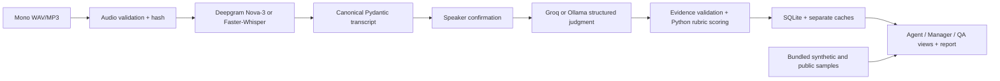

# CallIQ

**Every Call Counts. Every Insight Matters.**

CallIQ is a Streamlit MVP for post-call contact center QA and agent coaching. It turns a mono recording or an existing transcript into a structured preliminary evaluation, checks every cited transcript segment, calculates a deterministic rubric score, and presents the result to agents, managers, and QA analysts.

The bundled fallback includes six **synthetic, manually authored** calls and provisional QA findings. Four have synthetic text-to-speech MP3 recordings. The repository also includes eight selected calls from the public [Gridspace-Stanford HarperValleyBank dataset](https://github.com/cricketclub/gridspace-stanford-harper-valley), with its human-corrected transcripts and aligned mixed audio. A 25-second two-speaker opening excerpt is bundled for live processing tests. The corpus has **no human-validated CallIQ QA scores**. Evaluating a corpus call requires a configured LLM.

## Run locally

Python 3.11–3.14 is recommended. FFmpeg is needed only to rebuild bundled audio samples, not to run the app. On Windows:

```powershell
python -m venv .venv
.\.venv\Scripts\Activate.ps1
python -m pip install -r requirements.txt
python -m streamlit run app.py
```

Or run `./start.ps1`. The saved synthetic demo works without keys. To enable live processing, copy `.env.example` to your own environment variable setup or put credentials in `.streamlit/secrets.toml` (never commit that file):

```toml
DEEPGRAM_API_KEY = "..."
GROQ_API_KEY = "..."
TRANSCRIPTION_PROVIDER = "deepgram"
LLM_PROVIDER = "groq"
```

The app accepts authorized English mono WAV/MP3 recordings up to 20 MB and 15 minutes. Live upload uses Deepgram Nova-3 with `diarize_model=latest`, asks the user to confirm the agent speaker, then evaluates using Groq `openai/gpt-oss-20b` with strict JSON schema output. The model returns judgments; Python validates evidence and computes scores. Missing keys produce visible errors and leave saved samples available. API quotas and charges depend on the provider account.

If transcription is unavailable, **Analyze Call → Manual transcript** accepts authorized, role-labeled turns in `start|end|agent-or-customer|text` format. Times are supplied in seconds; CallIQ does not invent timestamps or roles. This path still needs an LLM key to generate a fresh evaluation.

For experimental local inference, install `requirements-local.txt`, install [Ollama](https://ollama.com/) and pull `qwen3:4b`, then run `./start.ps1 -Local`. Faster-Whisper defaults to CPU `small.en` and `int8`; set `WHISPER_DEVICE=cuda` and an appropriate `WHISPER_COMPUTE_TYPE` only after verifying CTranslate2/CUDA compatibility. Local diarization is **not implemented**: its transcript uses an unknown speaker, so it is unsuitable for reliable agent scoring until roles are resolved. No large model is installed by the base requirements.

## Demo walkthrough

1. **Overview:** describe why sampled manual QA misses calls. Metrics are explicitly labeled as synthetic samples.
2. **Analyze Call → Saved demonstration:** listen to `demo-balance-01` (strong), `demo-card-02` (critical issue), and `demo-escalation-06` (uncertain). Inspect exact transcript evidence, coverage, and coaching.
3. **Analyze Call → Public corpus:** play a HarperValleyBank call and inspect its human-corrected transcript. With a Groq key, evaluate it live.
4. **Analyze Call → Upload and process:** choose the bundled 25-second two-speaker sample or upload authorized mono audio, transcribe, inspect the diarized turns, confirm speaker roles, then evaluate. The bundled clip is an opening excerpt: later steps remain unassessed, and CallIQ withholds its score if coverage is below 50%. The TTS samples use one voice and are not suitable for testing diarization. If transcription fails, use **Manual transcript** with an authorized role-labeled transcript. These paths require LLM credentials; audio transcription also requires a transcription provider.
5. **Agent Dashboard:** inspect an alias's call history and coaching.
6. **Manager Dashboard:** compare aliases and recurring criteria.
7. **QA Analyst:** review the priority queue and record a human decision. This is a demo workflow, not access control.
8. **Performance Reports:** select dates, preview and download HTML. No email is sent.
9. **Architecture & About:** explain the AWS migration path.

## Architecture



Rubric `banking-v1` assigns 10% greeting, 25% identity verification when applicable, 20% understanding, 30% resolution, and 15% closing. `NOT_APPLICABLE` is removed from the denominator. `INSUFFICIENT_EVIDENCE` is excluded from the score calculation and reduces displayed score coverage. For the bundled opening excerpt, later-step outcomes become insufficient evidence; scores below 50% coverage are withheld. Critical failures are flagged independently. A finding with an unknown segment ID is rejected, and an uncited pass or failure becomes insufficient evidence. All AI outputs are preliminary and need human QA before consequential use.

In `APP_MODE=local`, SQLite stores evaluations, separate transcription/evaluation caches, and QA review history. Cache keys include audio hash or full transcript, provider/model, prompt and rubric versions, and agent alias. In the default online mode, uploaded calls, generated evaluations, and human review notes stay in the current Streamlit browser session and appear across its dashboards and reports, so visitors do not see each other's content through a shared SQLite file. Bundled sample data reloads on startup. A production deployment needs external storage and user authentication.

## Dataset and attribution

The bundled public sample was selected by `scripts/prepare_harpervalley.py` from eight different task types: card replacement, balance inquiry, transfer, appointment, branch hours, password reset, checks, and bill payment. The script downloads only those calls through the authenticated GitHub CLI, retains original agent/caller tracks in ignored `data/harpervalley/raw/`, mixes their parallel sample positions to mono, compresses to MP3, and writes canonical transcript JSON. Run it again with `python scripts/prepare_harpervalley.py` to reproduce the subset. Review the source [license](https://github.com/cricketclub/gridspace-stanford-harper-valley/blob/master/LICENSE) and [dataset description](https://github.com/cricketclub/gridspace-stanford-harper-valley) before redistribution. Attribution: Wu, Nafziger, Scodary, and Maas, *HarperValleyBank: A Domain-Specific Spoken Dialog Corpus* (2020), CC BY 4.0. Synthetic CallIQ scripts and TTS recordings are separate and clearly labeled.

## Testing

```powershell
python -m pip install -r requirements-dev.txt
python -m pytest -q
```

Tests cover audio validation, Deepgram normalization, speaker mapping, deterministic scoring, evidence rejection, short excerpts, session isolation, critical flags, SQLite, caching, and reports. Streamlit's `AppTest` checked all seven views after the latest quality fix with a visitor analysis in session state. A live Deepgram/Groq flow was verified on the deployed app; see [validation record](docs/validation.md).

## Deployment

1. Push this repository to GitHub, with `app.py` as the Streamlit entrypoint.
2. In [Streamlit Community Cloud](https://share.streamlit.io/), create an app from the repository and main branch.
3. Set `DEEPGRAM_API_KEY` and `GROQ_API_KEY` in the app's Secrets only if live processing is desired. Saved samples need no keys.
4. Open the public URL and verify audio, transcript, dashboards, and report from a separate browser session. Test a small authorized live upload if keys are configured.

The code has no account login, private customer data protection, or multi-tenant isolation. Use only public/synthetic recordings in a public demo. Do not submit TCS or client recordings to external providers without authorization.

The original application code has no open-source license yet because ownership/redistribution rights for an internal innovation project should be confirmed first. The bundled HarperValleyBank subset retains its separate CC BY 4.0 attribution.

## Enterprise roadmap

The modular Python pipeline can migrate to S3 uploads, Step Functions orchestration, Transcribe or self-hosted ASR, Bedrock or another approved model, Aurora PostgreSQL, CloudWatch, and approved SES report delivery. Production work includes authentication, role permissions, client isolation, encryption, retention, PII redaction, policy versioning, prompt-injection defenses, vendor review, asynchronous retries, and human QA governance. The current interface's three roles are demonstration views, not security boundaries.

## Current limits

- The live provider flow was verified once, before the excerpt-scoring safeguard. The safeguard is covered by automated tests and has not incurred another provider call.
- Local Faster-Whisper/Ollama adapters are experimental; local diarization is pending.
- QA corrections are audited as decisions/notes but do not yet change scores.
- Streamlit Community Cloud storage is temporary without an external database.
- Synthetic audio uses a single Windows TTS voice at different speaking rates and is intentionally not presented as a natural recording.
