# CallIQ technology decisions and enterprise path

CallIQ is a working **post-call QA MVP** for a public demonstration using synthetic and public sample recordings. Its current stack was chosen to prove the product loop quickly: transcribe a recording, identify speakers, produce evidence-linked preliminary findings, calculate a transparent score, and show coaching and review views. This document explains those choices and the options we would evaluate for a TCS-scale deployment across clients, contact centers, languages, and regions. The enterprise architecture below is a **proposal, not an implemented or TCS-approved deployment**.

## Decision summary

| Layer | Why the MVP uses it | What we would evaluate for enterprise use |
| --- | --- | --- |
| **Deepgram Nova-3** | One prerecorded-audio API returns transcription, word timestamps, and speaker labels. This lets the demo link a QA finding to a specific part of the call. | Keep Deepgram hosted if vendor, region, privacy, throughput, and contract requirements are approved; evaluate [Deepgram self-hosted](https://developers.deepgram.com/docs/deployment-options), [Amazon Transcribe Call Analytics](https://docs.aws.amazon.com/transcribe/latest/dg/call-analytics.html), and [Azure AI Speech batch transcription](https://learn.microsoft.com/en-us/azure/ai-services/speech-service/batch-transcription). Select per client and language using measured accuracy, diarization, PII handling, latency, and cost. |
| **Groq with `openai/gpt-oss-20b`** | Fast hosted inference and [strict JSON-schema output](https://console.groq.com/docs/structured-outputs) make it practical to get one structured finding per rubric criterion and coaching suggestions. | Assess an approved Groq enterprise arrangement, [Amazon Bedrock structured outputs](https://docs.aws.amazon.com/bedrock/latest/userguide/structured-output.html), [Azure OpenAI structured outputs](https://learn.microsoft.com/en-us/azure/ai-foundry/openai/how-to/structured-outputs), or a dedicated/self-hosted model. Compare evidence fidelity, rubric consistency, language coverage, residency, operational limits, and total cost. |
| **Python** | It connects provider adapters, Pydantic transcript/judgment models, evidence checks, scoring, caching, and reports in one readable codebase. The LLM proposes judgments; **Python validates cited segment IDs and calculates the score**. | Retain the tested domain logic as containerized API and worker services. Add asynchronous jobs, durable storage, observability, policy versioning, and load testing. A full language rewrite is not a prerequisite for scale. |
| **Streamlit** | It made a complete, inspectable demo possible quickly, including audio, evidence, dashboards, and report previews. | Build a production web experience, for example React/TypeScript backed by a Python API, integrated with the client's SSO, role permissions, tenant isolation, accessibility, and audit requirements. Streamlit could remain an approved internal analyst tool. [Community Cloud hosts apps in the US](https://docs.streamlit.io/deploy/streamlit-community-cloud/status), so this public demo hosting is not a default for region-restricted customer recordings. |
| **SQLite / Streamlit session** | SQLite supports local evaluation history and caches; the public app keeps visitor-generated results in each visitor's Streamlit session. This avoids needing a database for the demonstration. | Use a durable managed database such as PostgreSQL/Aurora or the client's approved equivalent, with explicitly designed tenant isolation, retention, backups, and audit records. Use encrypted object storage for audio and transcripts. |

## Why these choices work together

The integration is intentionally split at the transcript and judgment boundaries. The [Deepgram adapter](../src/transcription/providers.py) produces a canonical transcript with timestamps and generic speaker IDs. A user confirms which speaker is the agent; diarization alone does **not** establish a person's role. Deepgram [documents word-level speaker labeling](https://developers.deepgram.com/docs/diarization/), which makes evidence references possible. The current request is fixed to English, mono WAV/MP3, and prerecorded analysis; it does not prove multilingual or real-time readiness.

The [Groq adapter](../src/evaluation/providers.py) requests a constrained JSON judgment. A valid schema only means the response has the expected structure; it does **not** make a finding correct. CallIQ checks that cited segment IDs exist, marks unsupported judgments as insufficient evidence, and computes the weighted score in [Python](../src/evaluation/scoring.py). Human QA must still approve consequential findings. The local Faster-Whisper and Ollama adapters are experimental; local diarization is not implemented, so they are not drop-in substitutes for the complete two-speaker flow.

Streamlit is the presentation layer for this proof of concept, not the security boundary. The Agent, Manager, and QA views are demo perspectives, not authenticated roles. Production access control must be enforced by the API and data layer, not by hiding menu items. The current app has no customer login, enterprise tenant isolation, or durable cloud storage.

## Reference architecture for a large contact-center estate

Deploy separate data-processing boundaries according to each client's contractual and regional requirements. A global organization should not assume that every customer recording may flow into one region or one vendor account. Approve where raw audio is processed **before** sending it to an ASR provider; transcript redaction later in the pipeline cannot undo an unauthorized audio transfer.

```mermaid
flowchart LR
    A[Approved call-platform connector] --> B[Regional encrypted object storage]
    B --> C[Queue / workflow + idempotent job ID]
    C --> D[Approved ASR + diarization]
    D --> E[Canonical transcript + speaker-role check]
    E --> F[PII controls + approved LLM]
    F --> G[Evidence validation + versioned Python rubric]
    G --> H[Durable results + audit log]
    H --> I[SSO-protected Agent / Manager / QA web app]
    I --> J[Human review and corrections]
    J --> H
```

The first production increment would use **asynchronous post-call processing**, rather than holding an interactive request open for every call. The queue/workflow would handle retries, back-pressure, provider rate limits, failed-job review, and replay without duplicate evaluations. AWS [Step Functions Distributed Map](https://docs.aws.amazon.com/step-functions/latest/dg/state-map-distributed.html) is one possible batch orchestration tool; the client's cloud standard may call for another. Audio, transcripts, model outputs, rubric versions, reviewer decisions, and access events need distinct retention and access policies. PII redaction must be validated against the actual supported languages, regions, and accuracy; choosing a cloud service alone does not guarantee it.

This design keeps provider adapters replaceable, but changing providers still requires integration and regression testing. Timestamp conventions, speaker IDs, schema support, language behavior, and confidence signals differ. The same rubric and evidence rules should run against every provider so that comparisons are meaningful. For high-risk findings, route the call to a person rather than presenting the model output as a final compliance decision.

## How to choose the enterprise stack

Run a pilot with authorized, representative recordings from **each target language, accent mix, call type, recording format, and client policy**. Build a human-labeled reference set with adjudication for disagreements. Before selection, set client-specific acceptance criteria for:

1. **Transcription and diarization:** word error rate, speaker attribution errors, and timestamp quality on real contact-center audio.
2. **QA quality:** agreement with trained reviewers, evidence citation accuracy, missed critical issues, false alarms, and usefulness of coaching.
3. **Operations:** processing latency at the expected daily peak, queue recovery, provider quotas, observability, and cost per completed call (including human review).
4. **Governance:** approved data region and subprocessor terms, consent, encryption, secret management, SSO/RBAC, tenant isolation, retention/deletion, auditability, and model/rubric change control.

The decision may differ by client or region. Do not declare one ASR or LLM the universal winner from the MVP demo. Keep the current Streamlit/Deepgram/Groq combination for the synthetic public presentation; move real customer data only after the relevant approvals and pilot gates are met.

## Current scope and next implementation steps

- **Implemented now:** English post-call transcription through Deepgram, structured Groq judgments, deterministic Python scoring and evidence checks, saved synthetic cases, and Streamlit role views. Local SQLite and experimental local adapters are available as documented in the [README](../README.md).
- **Next engineering work:** authenticated API and UI, durable tenant-aware storage, approved ingestion, async orchestration, privacy controls, provider evaluation harness, operational monitoring, and reviewer correction workflows that feed governed rubric/model improvements.
- **Not established by this MVP:** TCS procurement approval, global data residency, production service levels, multilingual accuracy, enterprise capacity, or quantified ROI.

Provider capabilities and hosting terms can change. Recheck the linked official documentation and contractual terms when designing a client deployment.
